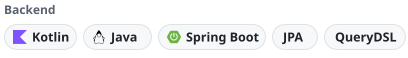

## 안녕하세요, 개발자 이정현입니다 👋

<!-- 링크 칩은 scripts/build-readme.mjs 의 links 가 굽는다. 글자를 바꾸려면 거기서 고치고 다시 돌린다. -->
<a href="https://juunghyun.github.io"><picture><source media="(prefers-color-scheme: dark)" srcset="assets/links/blog-dark.svg"></picture></a>
<a href="mailto:forcomfe81@gmail.com"><picture><source media="(prefers-color-scheme: dark)" srcset="assets/links/email-dark.svg"></picture></a>
<a href="https://juunghyun.github.io/about/"><picture><source media="(prefers-color-scheme: dark)" srcset="assets/links/resume-dark.svg"></picture></a>

## Motto

<!-- 문장은 scripts/build-readme.mjs 의 mottos 가 굽는다. 글자를 바꾸면 scripts/build-fonts.sh 의 TEXT 도 바꾸고 둘 다 다시 돌린다. -->
<p>
  <picture><source media="(prefers-color-scheme: dark)" srcset="assets/motto/1-dark.svg"></picture>
  <picture><source media="(prefers-color-scheme: dark)" srcset="assets/motto/2-dark.svg"></picture>
  <picture><source media="(prefers-color-scheme: dark)" srcset="assets/motto/3-dark.svg"></picture>
</p>

## Career

```yaml
2025.12 ~ Present: Backend Engineer at MIDAS IT (ONSITE dev team), Korea
2023.03 ~ 2023.09: Backend Engineer at Fisolution R&D Center, Korea
2018.03 ~ 2024.02: B.S. in Computer Engineering, Hongik University, Seoul, Korea
```

## Open Source Contributions

<!-- 카드 한 장 = scripts/build-readme.mjs 가 굽는 SVG 하나(글꼴 · 형광펜 · 별 수 · 머지 PR 수 포함). 숫자는 Action 이 매일 다시 굽는다. 새 카드는 스크립트의 projects 에 넣고 돌린 뒤 아래 <a> 를 하나 복사해 붙인다. -->
<p>
  <a href="https://github.com/HKUDS/DeepTutor/pulls?q=is%3Apr+is%3Amerged+author%3Ajuunghyun"><picture><source media="(prefers-color-scheme: dark)" srcset="assets/oss/deeptutor-card-dark.svg"></picture></a>
  <a href="https://github.com/ranxianglei/billion-context/pulls?q=is%3Apr+is%3Amerged+author%3Ajuunghyun"><picture><source media="(prefers-color-scheme: dark)" srcset="assets/oss/billion-context-card-dark.svg"></picture></a>
</p>

## Writing

<!-- 글 목록은 scripts/build-readme.mjs 가 블로그 RSS 와 graph.json 을 읽어 채운다. 한 줄 요약은 블로그 글 머리말의 summary 다. 여기를 손으로 고치면 다음 실행 때 덮어쓴다. -->
<!-- writing starts -->
**[AX를 하고 싶은데 할 곳이 없어? 그럼 오픈소스로 가자](https://juunghyun.github.io/posts/oss-from-scratch/)**<br>
맨땅에서 오픈소스 컨트리뷰터가 되어 본 기록<br>
<picture><source media="(prefers-color-scheme: dark)" srcset="assets/writing/oss-from-scratch-dark.svg"></picture>

**[클로드 계정 두 개를 더 쉽게 사용하기](https://juunghyun.github.io/posts/cc-baton/)**<br>
대화를 요약 없이 통째로 옮기는 도구를 만들며 내린 선택과 실패했던 지점들<br>
<picture><source media="(prefers-color-scheme: dark)" srcset="assets/writing/cc-baton-dark.svg"></picture>

**[refreshToken에 HttpOnly 하나 붙이는 데 사흘이 걸렸다](https://juunghyun.github.io/posts/httponly-refresh-token/)**<br>
HttpOnly가 막는 것과 못 막는 것, 그리고 배포 뒤에 찾은 재발급 경합<br>
<picture><source media="(prefers-color-scheme: dark)" srcset="assets/writing/httponly-refresh-token-dark.svg"></picture>

**["형식은 제각각인데, 니가 완벽한 엑셀 파서 만들어 줘" 해결하기](https://juunghyun.github.io/posts/perfect-excel-parser/)**<br>
LLM에게 맡길 일과 코드가 할 일을 나눈 기준<br>
<picture><source media="(prefers-color-scheme: dark)" srcset="assets/writing/perfect-excel-parser-dark.svg"></picture>

**[기술 블로그를 시작하는 이유](https://juunghyun.github.io/posts/why-i-started-this-blog/)**<br>
내가 마주한 문제와 해결을 내 언어로 기록한다<br>
<picture><source media="(prefers-color-scheme: dark)" srcset="assets/writing/why-i-started-this-blog-dark.svg"></picture>
<!-- writing ends -->

## Tech Stack

<!-- 묶음은 scripts/build-readme.mjs 의 stack 이 굽는다. -->
<p>
  <picture><source media="(prefers-color-scheme: dark)" srcset="assets/stack/backend-dark.svg"></picture>
  <picture><source media="(prefers-color-scheme: dark)" srcset="assets/stack/data-dark.svg"></picture>
  <picture><source media="(prefers-color-scheme: dark)" srcset="assets/stack/infra-dark.svg"></picture>
  <picture><source media="(prefers-color-scheme: dark)" srcset="assets/stack/observability-dark.svg"></picture>
</p>
