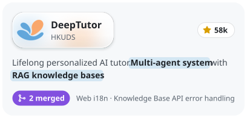
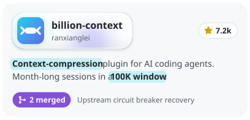

## 안녕하세요, 개발자 이정현입니다 👋

[](https://juunghyun.github.io)
[](mailto:forcomfe81@gmail.com)
[](https://juunghyun.github.io/about/)

## Motto

- 기록해야 뒤돌아본다.
- 관성을 깨야 변화한다.
- 꾸준함도 재능이다.

## Career

```yaml
2025.12 ~ Present: Backend Engineer at MIDAS IT (ONSITE dev team), Korea
2023.03 ~ 2023.09: Backend Engineer at Fisolution R&D Center, Korea
2018.03 ~ 2024.02: B.S. in Computer Engineering, Hongik University, Seoul, Korea
```

## Open Source Contributions

<!-- 카드 한 장 = scripts/build-oss-cards.mjs 가 굽는 SVG 하나(글꼴 · 형광펜 · 별 수 · 머지 PR 수 포함). 숫자는 Action 이 매일 다시 굽는다. 새 카드는 스크립트의 projects 에 넣고 돌린 뒤 아래 <a> 를 하나 복사해 붙인다. -->
<p>
  <a href="https://github.com/HKUDS/DeepTutor/pulls?q=is%3Apr+is%3Amerged+author%3Ajuunghyun"><picture><source media="(prefers-color-scheme: dark)" srcset="assets/oss/deeptutor-card-dark.svg"></picture></a>
  <a href="https://github.com/ranxianglei/billion-context/pulls?q=is%3Apr+is%3Amerged+author%3Ajuunghyun"><picture><source media="(prefers-color-scheme: dark)" srcset="assets/oss/billion-context-card-dark.svg"></picture></a>
</p>

## Writing

<!-- writing starts -->
- ["형식은 제각각인데, 니가 완벽한 엑셀 파서 만들어 줘" 해결하기](https://juunghyun.github.io/posts/perfect-excel-parser/) · 2026.10.06
- [기술 블로그를 시작하는 이유](https://juunghyun.github.io/posts/why-i-started-this-blog/) · 2026.09.22
<!-- writing ends -->

## Tech Stack

- Kotlin · Java · Spring Boot · JPA · QueryDSL
- MariaDB · MongoDB · Redis · Kafka
- AWS · EKS · Docker · AWS Batch
- Datadog · CloudWatch
